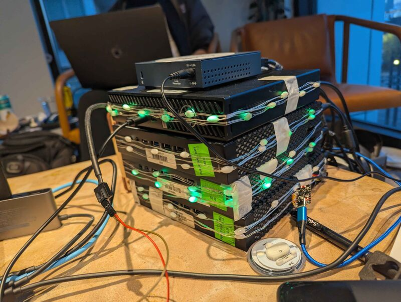
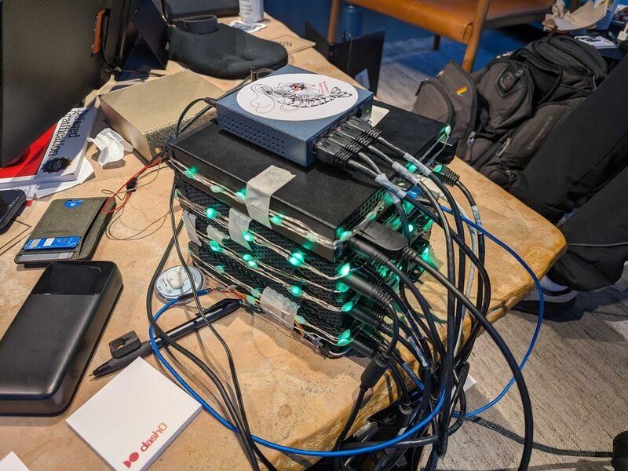
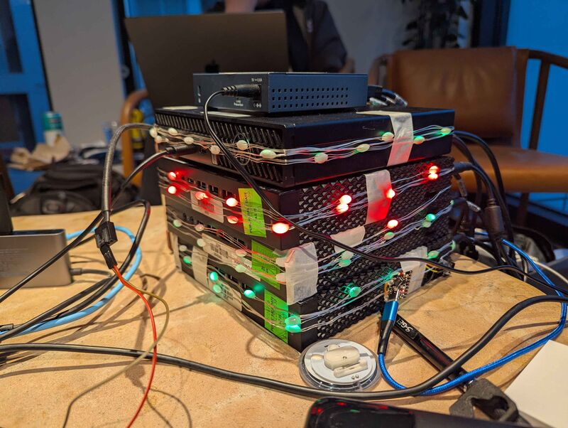
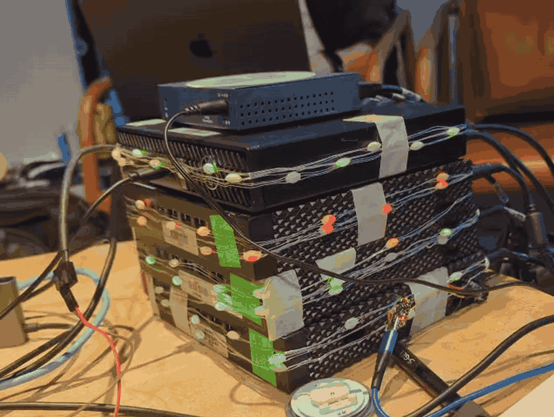

# Asked & Answered

The Q&A at the end of a talk is often the best part, and it's gone the moment the talk ends. Asked & Answered keeps it. The presenter's phone turns the talk into text as they speak. The app splits the Q&A part into question-and-answer pairs, and everything lands in one archive you can search by meaning. During the conference, attendees can check whether their question was already asked. Afterward, people and their AI agents can search every session and jump to the passage.

Only text reaches the server. The phone's browser does the speech-to-text (Chrome uses Google's speech service for it), and no audio or video is stored. A browser with no speech-to-text of its own downloads a small model from the app and runs it on the phone instead; before a deploy from a fresh clone, `nr --filter '@web-template/web' speech-model:fetch` puts that model in place.

## The Cluster

The app runs on a small physical k3s cluster: four mini PCs stacked together and wrapped in LED string lights, with a gigabit switch on top. One machine is the control node and gateway; the other three are workers.

|  |  |
| :---: | :---: |
| **The stack.** Four mini PCs, all lights green. | **The cabling.** Power and network, all on one desk. |
|  |  |
| **A single error.** One strip turns red while the rest stay green. The red strip is a severe, active issue for that node, pulled from the Radar API. | **Blinking.** The lights in motion, with the same red strip: a severe, active issue for that node, from Radar. |

## Pages

| Route            | What it shows                                                                                   |
| ---------------- | ----------------------------------------------------------------------------------------------- |
| `/`              | The archive: search, the Ask box, the hourly "what people are asking" note, and counts.        |
| `/sessions`      | Every session, newest first.                                                                    |
| `/sessions/$id`  | One session: its pairs and transcript. `?t=<seconds>` jumps to a passage.                       |
| `/questions`     | What attendees typed into the archive, unanswered ones first. Needs the presenter code.         |
| `/record`        | The presenter's recorder, for a phone. Needs the presenter code.                                |
| `/mcp`           | A read-only MCP endpoint for AI agents (not a page).                                            |

Every question typed into the search field or the Ask box is saved to the `question_log` table with no name attached, along with whether the archive already had an answered question for it. Presenters open Questions with the presenter code to see what people want to know, with the unanswered ones set apart, so they can cover those in their talk. It needs the code because strangers write that text, and it is never shown on a public page.

## Run It Locally

```sh
mise trust && mise install
pnpm install
mise run dev                  # forwards the cluster's Postgres, then starts the dev server
```

`mise run dev` reads the database password and the presenter code from the cluster, so `.env` needs neither. To run the two steps yourself, use `mise run k8s:db` in one terminal and `node --run dev` in another, with `DATABASE_URL` set as that task prints.

`apps/web/README.md` has the details, and `AGENTS.md` describes the commands and conventions.

## Settings

Put these in `.env` for local work. `mise run k8s:deploy` copies the Elastic, Kibana, OpenRouter, and tunnel values into Kubernetes Secrets, and makes a random presenter code for the cluster. The cluster uses the defaults for the rest.

| Variable                       | Default                                       | What it's for                                                         |
| ------------------------------ | --------------------------------------------- | --------------------------------------------------------------------- |
| `PRESENTER_CODE`               | none                                          | The shared code for `/record`. Unset means no recording.              |
| `ELASTICSEARCH_URL`            | none                                          | Elastic project endpoint.                                             |
| `ELASTICSEARCH_API_KEY`        | none                                          | Elastic API key, also used for Kibana.                                |
| `KIBANA_URL`                   | `ELASTICSEARCH_URL` with `.es.` as `.kb.`     | Agent Builder and Workflows.                                          |
| `ELASTICSEARCH_ARCHIVE_INDEX`  | `asked-archive`                               | Search index for segments and pairs.                                  |
| `ELASTICSEARCH_DIGEST_INDEX`   | `asked-digest`                                | Where the hourly note is written.                                     |
| `ELASTIC_LLM_INFERENCE_ID`     | `.anthropic-claude-5-sonnet-chat_completion`  | Elastic's LLM, tried first for the split. It answers 403 here today.  |
| `ELASTIC_AGENT_ID`             | `asked-and-answered`                          | The Agent Builder agent behind the Ask box.                           |
| `ASK_BUDGET_USD`               | `15`                                          | The most the Ask box may spend on the agent. `0` turns it off.        |
| `ASK_COST_ESTIMATE_USD`        | `0.10`                                        | Cost logged per question when the agent reports no token usage.      |
| `OPENROUTER_API_KEY`           | none (optional)                               | The LLM that splits the Q&A when Elastic's fails, which it does now.  |
| `OPENROUTER_MODEL`             | `anthropic/claude-haiku-5.5`                  | The OpenRouter model.                                                 |
| `CLOUDFLARE_TUNNEL_TOKEN`      | none (optional)                               | The named tunnel. Without it, a temporary `trycloudflare.com` address. |

### The Ask Box's Limits

Each question in the Ask box goes to a paid Elastic agent. The app writes every question to the `ask_log` table before sending it, so all three replicas share one count:

- More than 10 questions in a minute: "The archive is answering a lot of questions right now. Try again in a minute."
- Once the logged cost reaches `ASK_BUDGET_USD`: "The Ask box has used its budget for now. Search still works."

The cost of a question comes from the token usage the agent reports, priced at $6 per million input tokens and $30 per million output tokens, about twice the list price of its model. When it reports none, the question costs `ASK_COST_ESTIMATE_USD`. The $15 default plus the digest workflow's own cap (at most 50 paid runs, about $5) keeps the agent under $20 in all.

## Sample Data and Elastic Setup

```sh
mise run elastic:setup             # create the indices, the agent and its tools, and the digest workflow (safe to rerun)
mise run seed -- <url>             # push the sample talks in apps/web/seed/ through the real recording calls
```

The sample talks are invented, and their titles end in "(sample)".

## Connect an AI Agent

```sh
claude mcp add -t http asked <url>/mcp
```

The agent gets three read-only tools: `search_archive`, `list_sessions`, and `get_session`. Any of the three replicas can answer any request, because the endpoint keeps nothing a later request needs (see `docs/adr/0002-mcp-route-outside-orpc.md`).

## Deploy to the Cluster

The app runs on the team's Kubernetes cluster, reached over Tailscale. You don't need to know Kubernetes to ship it.

### Set Up Once

1. Join the tailnet.
2. Get the cluster login file (a "kubeconfig") from whoever runs the cluster. Save it as `~/.kube/hackathon.yaml`, then run `chmod 600 ~/.kube/hackathon.yaml`. It's an admin login, so never commit it or paste it anywhere public.
3. Install Docker:
   - macOS: [OrbStack](https://orbstack.dev).
   - Arch: `sudo pacman -S docker docker-buildx`, `sudo systemctl enable --now docker`, `sudo usermod -aG docker "$USER"`, then log out and back in.
4. Let Docker push images: `gh auth refresh -h github.com -s write:packages`, then `gh auth token | docker login ghcr.io -u <your-github-user> --password-stdin`.
5. Check it all works: `kubectl get nodes` lists the cluster's machines as `Ready`.

### Ship It

```sh
mise run k8s:deploy
```

This builds the app into a container image, scans it for secrets, pushes it to `ghcr.io`, and tells the cluster to run it. It takes about 20 seconds once the build is cached, and ends by printing the app's address. Database migrations run on their own when the app starts.

### Other Tasks

| Command                | What It Does                                                                  |
| ---------------------- | ----------------------------------------------------------------------------- |
| `mise run k8s:status`  | Shows what's running and on which machine.                                    |
| `mise run k8s:logs`    | Follows the app's logs. Ctrl+C stops following; the app keeps running.        |
| `mise run k8s:db`      | Connects `localhost:5432` to the cluster's database, for `db:studio`.         |
| `mise run k8s:down`    | Deletes the app and its database from the cluster, after asking.              |
| `mise run dash0:install` | Sends the app's traces, logs, and metrics to Dash0 (see below).             |
| `mise run dash0:down`  | Removes Dash0 from the cluster.                                               |

### Words You'll See

- **Image**: the app packed with everything it needs to run. Built by `docker`, stored on `ghcr.io`.
- **Pod**: one running copy of the app. There are three, on different machines, so one can crash without taking the site down.
- **Namespace**: a folder in the cluster. Everything here lives in `web`, apart from other teams' work.
- **Secret**: where passwords and keys live, like the database password and the presenter code. They're made inside the cluster by `k8s:deploy` and never written to this repository.
- **Tunnel**: a `cloudflared` pod in the `web` namespace. It gives the app a public HTTPS address, which phones need before they allow the microphone.

### Keep Secrets Out

The images on `ghcr.io` are public, and so is this repository. Never put a password or token in source code, and never in a `VITE_*` variable: Vite copies those into the browser code. `k8s:deploy` refuses to push an image that contains a known secret format or a Tailscale address, but it can't catch everything.

### When Something Breaks

- `kubectl` says "connection refused" or times out: Tailscale is off, or `~/.kube/hackathon.yaml` is missing.
- `k8s:deploy` says the cluster can't download the image: the `ghcr.io` package went private. Make it public again in its GitHub package settings.
- The site shows "no available server": the app pods aren't ready. `mise run k8s:status` and `mise run k8s:logs` show why.

## Hackathon Services

| Service                | What It Does Here                                                          | State                                         |
| ---------------------- | -------------------------------------------------------------------------- | --------------------------------------------- |
| Radar                  | Shows the cluster in a browser and lets agents inspect it over MCP.        | Agent runs in the `radar` namespace.          |
| Elastic                | Search by meaning, the Ask box agent, and the hourly digest Workflow.      | Needs keys in `.env`, then `elastic:setup`.   |
| Dash0                  | Traces, logs, and metrics for the app.                                     | Needs keys in `.env`, then `dash0:install`.   |
| Gitar (Sonar)          | Reviews every pull request. `.gitar/review/project.md` says what to check. | Installed on the GitHub organization.         |

### Radar

The cluster is already connected. To use it:

1. Sign in at <https://app.radarhq.io> and accept the team invite.
2. `.mcp.json` and `opencode.jsonc` list the `radar-cloud` MCP server. Sign in to it once: in Claude Code, run `/mcp`, pick `radar-cloud`, and choose Authenticate; in OpenCode, run `opencode mcp auth radar-cloud`.

### Elastic

1. Sign up at <https://ela.st/hack-kubecon> and create an **Elasticsearch** project ("Build AI and semantic search").
2. On the project's page, copy the Elasticsearch endpoint and create an API key. Put them in `.env` as `ELASTICSEARCH_URL` and `ELASTICSEARCH_API_KEY`. Set `ELASTICSEARCH_ARCHIVE_INDEX` to something like `asked-archive-dev-<your name>` so your laptop doesn't write into the cluster's index. The agent's tools and the digest only read `asked-archive`.
3. `mise run elastic:setup` creates the indices, the Agent Builder agent and its tools, and the digest workflow. `--run-workflow` also runs the digest once.
4. `mise run k8s:deploy` copies the keys into the cluster's `web-elastic` Secret.

The app indexes each segment as it arrives and each pair after a split, using the preconfigured `.jina-embeddings-v5-text-small` endpoint. Postgres stays the source of truth. Without the keys, recording still works and search reports that it isn't set up.

### Dash0

1. Sign up at <https://www.dash0.com/sign-up?utm_source=wemakedevs>.
2. Put the OTLP via gRPC endpoint, the API endpoint, and an auth token in `.env` (`DASH0_ENDPOINT`, `DASH0_API_ENDPOINT`, `DASH0_AUTH_TOKEN`). `.env.example` says where each one is.
3. One person runs `mise run dash0:install`.

That installs the Dash0 operator into `dash0-system` and monitors only the `web` namespace. The operator adds OpenTelemetry to the app's pods when they start, so the app has no tracing code of its own. The app's pods restart once. `mise run dash0:down` removes it all again.

## Keep the Template Current

`mise run sync` takes the tooling changes from `~/GitHub/voice` since the last sync, shows the diff, and applies it once you confirm. Hunks that no longer fit are left as `.rej` files to merge by hand.
